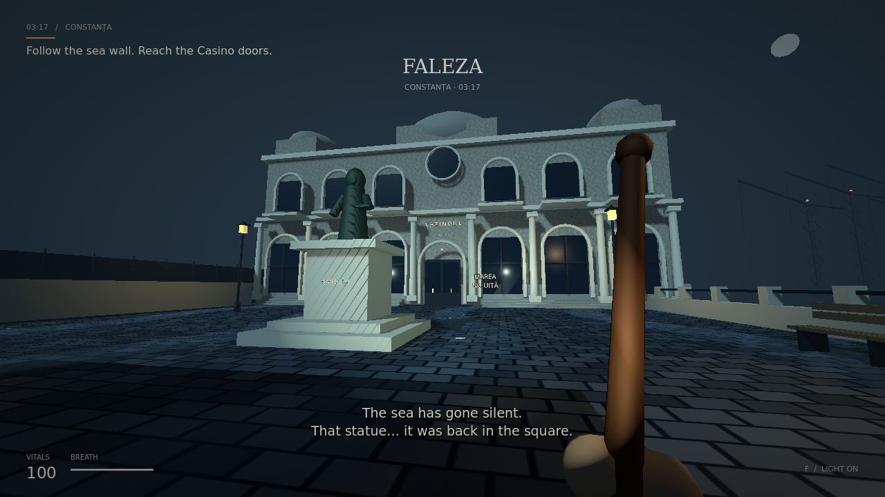

# Marea nu uită

**The Sea Doesn't Forget** — an original first-person psychological horror prototype set in a fictionalized Constanța, Romania. Built in **Godot 4**, tested with **Godot 4.6.3** and the Compatibility renderer.

A dead caller sends you through an empty city at 03:17. Answer the phone in Piața Ovidiu, find a ceramic fuse in the Old Town, restore power to the promenade gate, and reach the Casino. Something follows you. Something else remembers where the statue used to stand.



[Title screen](docs/screenshots/title.png) · [Old Town encounter](docs/screenshots/alley.png)

## Play

Open `project.godot` in Godot 4.6 and press **F5**, or run from this directory:

```sh
./run.sh
```

The launcher locates `godot` or `godot4` and supplies writable engine data/cache paths for cloud environments. A graphical display is required for interactive play. The source project runs directly; no export templates, package manager, credentials, downloaded assets, or network access are needed.

| Control | Action |
| --- | --- |
| WASD | Move |
| Mouse | Look |
| Shift | Sprint; consumes breath, which recovers while walking or resting |
| F | Toggle flashlight |
| E | Interact with the object you are looking at when prompted |
| Left mouse | Swing the pipe; three hits kill the enemy |
| Esc | Pause / resume; releases the mouse |

The enemy can be fought or evaded. There is no jumping. Death and the ending both offer a full restart. Menus support mouse and keyboard navigation.

## What is implemented

- One complete, short route: square → narrow Old Town alley → gated promenade → Casino entrance.
- Procedural architecture, Ovid statue, balconies, café furniture, parked car, seawall, distant port cranes, and a stylized Casino facade.
- Wet cobblestone and animated water shaders, fog, moonlight, amber streetlamps, flashlight, film grain, and vignette.
- A ringing-phone story introduction, fuse inventory and gate puzzle, location cards, prompts, and English narrative subtitles with Romanian environmental signage.
- An original salt-bound enemy with pursuit, attack animation, damage, death, blood, and fishing-wire details. Player melee includes a range/cone check, cooldown, and line-of-sight check.
- A supernatural landmark displacement and an actual silence in the sea ambience after crossing the gate.
- Procedurally synthesized sea/wind/drone ambience, footsteps, phone, combat, and gate cues.
- Title, pause, death, ending, restart, health, and stamina UI.

This is an early gameplay and atmosphere prototype with stylized procedural art. It is not a finished game or an accurate reconstruction of the city. The playable slice ends at the Casino doors; the Casino interior, larger port level, firearms, save system, and recorded voice acting are future work. No Cry of Fear assets or code are included.

## Validate

```sh
./run.sh --headless --script res://tests/smoke.gd
```

The integration suite instantiates the actual game scene and checks startup, player movement and grounding, interactable targeting, puzzle order, gate collision before/after unlocking, melee damage and cooldown, pause/resume, flashlight, death/restart, the environmental change, and ending. It exits nonzero on failure. Headless execution validates gameplay; use a graphical run to inspect the visuals and sound.

## Structure

| File | Responsibility |
| --- | --- |
| `scripts/main.gd` | Scene composition, interaction state machine, puzzle, story events, restart |
| `scripts/world.gd` | Procedural geometry, materials, collision, lighting |
| `scripts/player.gd` | First-person controls, flashlight, pipe combat, player state |
| `scripts/enemy.gd` | Monster mesh, pursuit, attacks, damage and corpse |
| `scripts/hud.gd` | Menus, prompts, subtitles, vitals and screen effects |
| `scripts/ambience.gd` | Procedural audio generation and playback |
| `tests/smoke.gd` | Runtime integration tests |

Each cloud task already has an isolated checkout; use the existing repository without creating a worktree. `.godot/` is generated locally and is ignored by Git.
